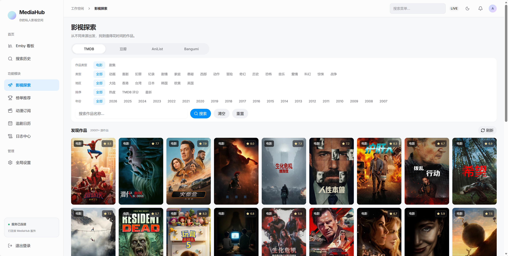
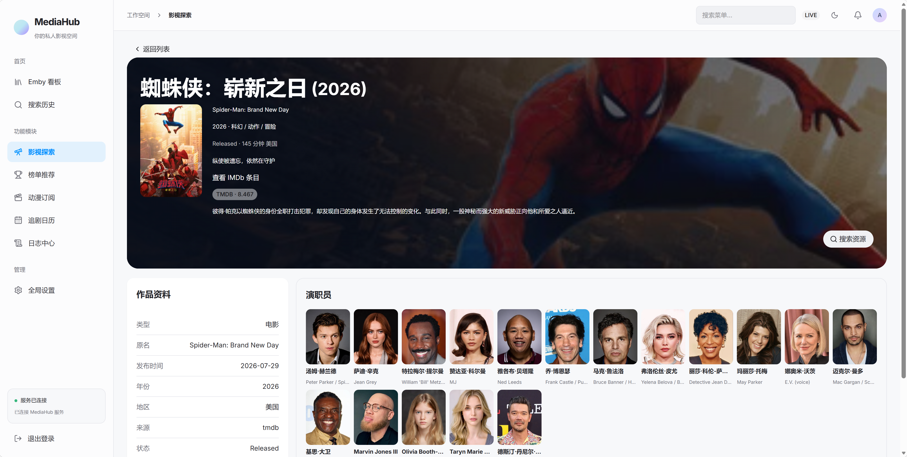
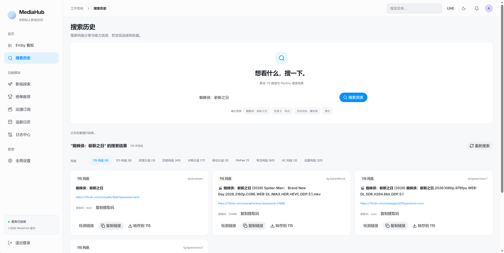
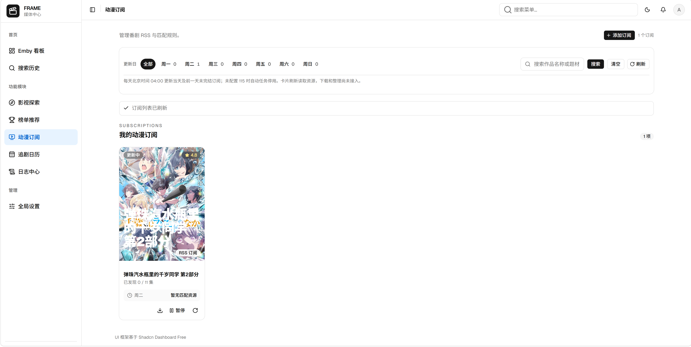
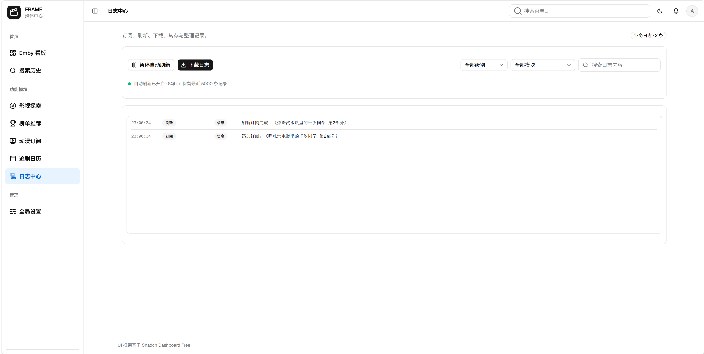
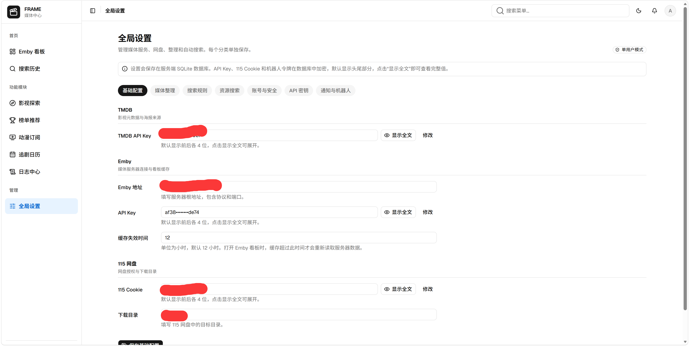
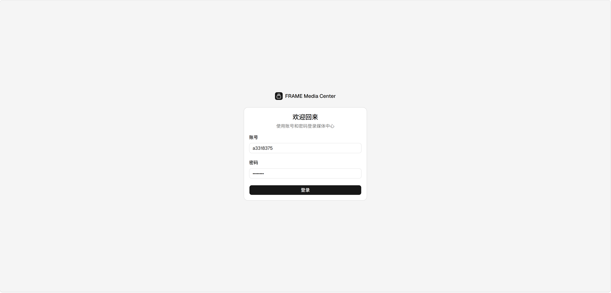

# MediaHub

缝合大师，一款0人工作品。
基于网盘的动漫和电影的自动化路线，一般是ani-rss + moviePolit(tgToDriver) + pansoou + openlist + emby。
我部署了这么一堆东西，太过于杂乱了，原理又不复杂，所以就让ai写了一个。
我本身是搞java的，没啥审美技术又一般，所以就让ai，用shadcn（react）  + go写的。
我其实不知道模仿其他人的代码，侵权不侵权，假如侵权，可以通知我，我隐藏起来。

**项目正在持续开发，欢迎试用、反馈问题和参与二次开发。** 当前已提供基础业务功能，完整自动化流程和使用体验还在完善。

## 能做什么

| 功能 | 你可以用它做什么 |
| --- | --- |
| 影视探索 | 浏览 TMDB、豆瓣、Bangumi、AniList 等来源的作品，按类型、地区、年份和评分等条件寻找想看的内容；具体筛选能力随来源不同 |
| 作品详情与榜单 | 查看简介、评分、海报和演职员信息，通过榜单发现作品，并从详情进入资源搜索 |
| 网盘资源搜索 | 使用内置 PanSou 聚合搜索资源，按网盘类型查看结果、复制分享链接，并调整搜索来源 |
| 动漫订阅 | 添加 RSS 订阅，配置字幕组、匹配规则和集数范围，查看发现的资源、更新进度，手动刷新或暂停订阅 |
| 115 下载与转存 | 提交离线下载，读取 115 分享目录并选择文件转存，查看任务状态及失败原因 |
| 媒体整理 | 配置未整理目录和目标目录，预览后执行整理，按规则改名、直接移动文件，并清理空文件夹；支持 Cron 定时整理 |
| Emby 看板 | 连接自己的 Emby，查看媒体库概况、最近添加和继续观看内容 |
| 中文业务日志 | 查看添加订阅、刷新、下载、转存和整理的操作与结果，支持筛选、搜索和导出 |
| 账号与设置 | 创建自己的管理员账号，集中管理服务连接、搜索配置和 API 密钥；敏感凭证在服务端加密保存 |

搜索支持多个网盘来源，当前下载、分享转存和整理主要围绕 **115** 实现。服务连接需要填写对应配置，实际结果也取决于来源可用性和服务器网络。

## 页面预览

点击缩略图可打开原图查看。

| 影视探索 | 作品详情 |
| :---: | :---: |
| [](docs/images/discover.png) | [](docs/images/media-detail.png) |
| 浏览多来源影视与动漫作品 | 查看作品资料、演职员并搜索资源 |

| 资源搜索 | 动漫订阅 |
| :---: | :---: |
| [](docs/images/resource-search.png) | [](docs/images/anime-subscriptions.png) |
| 聚合搜索网盘资源，按网盘分类查看 | 跟踪新集数，配置字幕组与匹配规则 |

| 中文业务日志 | 全局设置 |
| :---: | :---: |
| [](docs/images/business-logs.png) | [](docs/images/settings.png) |
| 筛选、搜索和导出业务操作记录 | 统一管理服务连接、搜索来源和通知 |

| 账号登录 |
| :---: |
| [](docs/images/login.png) |
| 首次部署创建管理员账号，之后使用该账号登录 |

截图来自开发版本，部分页面仍显示旧名称 FRAME，界面和功能会随版本更新。

## Docker 部署

前后端已经打包到一个镜像中，使用 Docker Compose 即可启动。

```yaml
services:
  media-center:
    image: ghcr.io/a3318375/mediahub:latest
    ports:
      - "5173:18080"
    volumes:
      - ./data:/data
    restart: unless-stopped
```

仓库根目录已有 `docker-compose.yml`。取得该文件后，在所在目录执行：

```sh
docker compose pull
docker compose up -d
```

打开 `http://服务器IP:5173`，创建管理员账号即可进入系统。服务器的 5173 端口需要可访问；如端口已被占用，修改映射左侧的端口。

### 开始使用

1. 在全局设置中配置需要使用的服务：TMDB、Emby 和 115 可以按需填写。
2. 从影视探索或资源搜索开始查找作品与资源。
3. 使用动漫订阅跟踪新集数，配置规则和下载范围。
4. 在媒体整理中选择未整理目录与目标目录，先预览，再执行；需要自动整理时填写 Cron。
5. 在下载记录和日志中心查看处理进度与结果。

账号、订阅、任务、配置和加密密钥都保存在挂载的 `./data` 中。升级或迁移时保留整个目录，不要只复制数据库；两个实例不要同时使用同一个数据目录。

### 更新版本

```sh
docker compose pull
docker compose up -d
```

镜像若为私有，需要先使用具备读取权限的账号执行 `docker login ghcr.io`。

## 当前还在做

- **Telegram 通知**：配置保存和消息发送已经验证，正在接入下载、转存、整理完成或失败的自动通知，以及页面测试入口。
- **115 操作体验**：优化目录选择速度，减少重复读取和等待，继续完善状态提示。
- **自动化流程验证**：下载、转存和整理已有实现，持续验证真实资源、失败恢复、目录冲突和空目录清理等情况。
- **追剧日历与界面完善**：日历入口及相关展示仍在完善，逐步统一 MediaHub 品牌与页面文案。

设置页面出现某个选项，不代表对应功能已完整接入。当前以实际可执行的业务流程为准，开发进度会继续更新。

## 参与开发

前后端放在同一个仓库，方便一起修改和构建：

```text
MediaHub/
├── web/                  # React 前端
├── api/                  # Go 后端
│   └── third_party/pansou/ # PanSou 子模块
├── docs/images/          # README 截图
├── Dockerfile
├── docker-compose.yml
└── README.md
```

```sh
git clone --recurse-submodules https://github.com/a3318375/MediaHub.git
cd MediaHub
```

Windows 本地开发，分别打开两个终端：

```powershell
# 后端
cd api
./scripts/dev.ps1
```

```sh
# 前端
cd web
pnpm install --frozen-lockfile
pnpm dev --host 127.0.0.1 --port 5173 --strictPort
```

前端默认把 API 请求转发到 `127.0.0.1:18080`，本地开发数据保存在仓库根目录 `data/`。默认连接真实后端，演示模拟模式需显式设置 `VITE_ENABLE_MOCKS=true`。

本地构建合并镜像，在仓库根目录执行：

```sh
docker build -f Dockerfile --build-context web=./web -t mediahub:local ./api
docker run --rm -p 5175:18080 -v mediahub-test-data:/data mediahub:local
```

此试运行使用独立数据卷，访问 `http://localhost:5175`。推送 `main` 后，GitHub Actions 会自动构建并发布 `latest` 和提交版本镜像。

## 致谢

资源搜索基于 [PanSou](https://github.com/fish2018/pansou)，项目通过固定版本的 fork 子模块集成。115 接口适配使用 [115driver](https://github.com/SheltonZhu/115driver)，前端使用 React、Vite 和 shadcn/ui。
